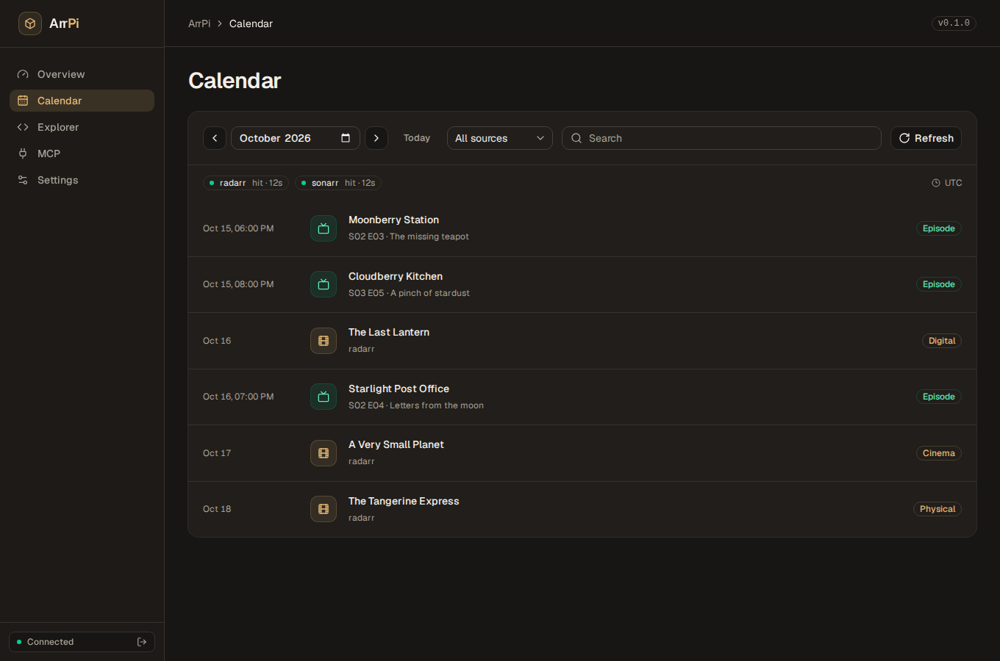
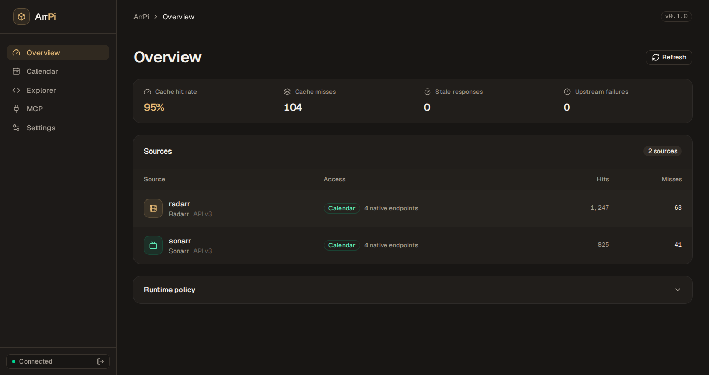
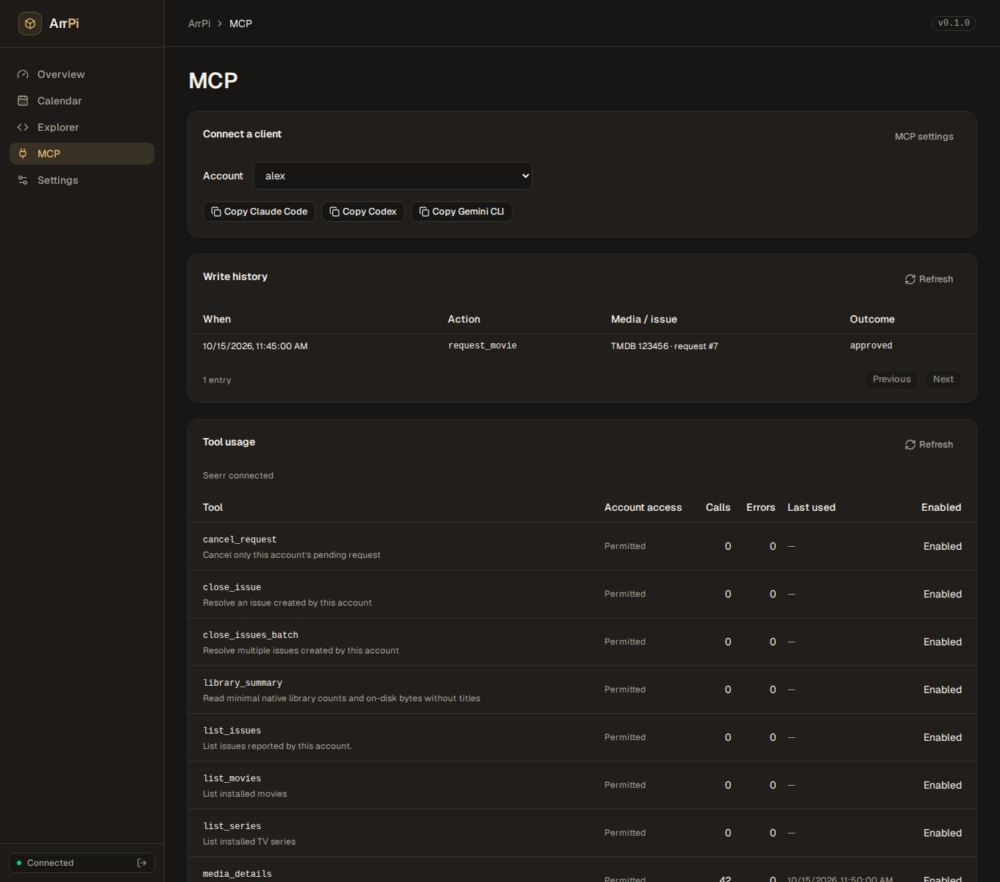

<!-- @generated by markupwright v0.1.3 -- do not edit by hand. Edit the source template and run `markupwright`. -->

# ArrPi

ArrPi puts [Sonarr](https://sonarr.tv/), [Radarr](https://radarr.video/) and [Seerr](https://seerr.dev/) behind a cached API, CLI and optional web UI. Build a media dashboard, follow upcoming releases or let an AI assistant search your library and request media through Seerr.

## What you can do

- **Dashboards:** cached library, queue and health data. Give each client a scoped key instead of sharing your apps’ API keys.
- **Calendar:** movie releases and TV episodes together, with search, filters and personal RSS/iCalendar feeds.
- **AI assistants:** search, recommendations, movie and season requests, issues and batch tools through MCP. Each account acts as its own Seerr user.
- **Scripts:** a JSON CLI for automation and agents.

## Screenshots

**Calendar**



| Source overview                                    | MCP connections and usage                                        |
| -------------------------------------------------- | ---------------------------------------------------------------- |
|  |  |

Screenshots use fictional media.

## MCP demo

Claude Code searches the library, checks upcoming releases, requests a movie and a TV season, manages an issue and retrieves watch links.


## Install

You need Docker with Compose v2, plus Sonarr v4, Radarr with the v3 API, or both.

### API and CLI

```sh
git clone https://github.com/legacy3/arrpi.git
cd arrpi
docker compose -f deploy/compose.yaml up --no-build --pull always -d --wait
docker compose -f deploy/compose.yaml exec arrpi config key
```

The API listens on `127.0.0.1:8780`. `config key` prints the admin key for setup.

### Web UI

Add the optional frontend:

```sh
docker compose -f deploy/compose.yaml -f deploy/compose.web.yaml up --no-build --pull always -d --wait
```

Both ports bind to loopback. For remote access, use a TLS reverse proxy; see [routing and SSO](docs/configuration.md#remote-access).

### Images

| Image                        | Contains                                 |
| ---------------------------- | ---------------------------------------- |
| `ghcr.io/legacy3/arrpi-core` | API, CLI, MCP server and SQLite state    |
| `ghcr.io/legacy3/arrpi-ui`   | Optional web frontend; no database mount |

Both images run non-root with read-only filesystems on Linux amd64 and arm64. Builds from `main` that pass CI publish `latest` and `sha-<full commit>` tags. Pin matching commit tags or digests when deploying the pair.

The UI reads `ARRPI_CORE_ORIGIN` at startup, so changing its core server does not require a rebuild.

## Set it up

Open `http://127.0.0.1:3000/` and enter the admin key. Add your apps’ URLs and API keys under **Settings → Connections**. ArrPi must be able to reach those URLs; for apps in Docker, use their service names on a shared network.

Create client keys under **Settings → Access** and choose which sources and operations each client can use. Use these keys in dashboards and scripts. Keep the admin key for managing ArrPi.

The calendar combines the connected Sonarr and Radarr libraries. **Explorer** lets you inspect API responses and request fresh upstream data. Personal RSS/iCalendar setup is covered in [feeds](docs/api.md#personal-feed-subscriptions).

## CLI

Set `ARRPI_URL` and `ARRPI_API_KEY` to your ArrPi server and client key, or use `--url` and `--key-env`.

```sh
# Read a library or download queue
arrpi get sonarr series --pretty
arrpi get radarr queue --page 1 --page-size 20 --no-cache --metadata

# Combine movie and episode releases
arrpi calendar --start 2026-10-01 --end 2026-10-31

# Find an available comedy
arrpi tool search_library --arguments '{"genres":["Comedy"],"available":true,"min_rating":7}'

# Check ArrPi or discover native apps
arrpi health
arrpi discover --ip 192.0.2.10
```

Output is JSON; failures return a nonzero exit code. Run `arrpi --help` for arguments.

For fresh data, use `--no-cache`, the web UI’s **Explorer → Fresh upstream read** checkbox or an MCP tool’s `no_cache` argument.

### Without Docker

Use `cargo run --locked -p arrpi -- <command>`. Rust 1.95 or newer is supported; the repository pins 1.96.1.

```sh
cargo run --locked -p arrpi -- serve --database .arrpi/arrpi.sqlite

# In another terminal:
cargo run --locked -p arrpi -- config key --database .arrpi/arrpi.sqlite
```

## MCP

Requests and issues are enabled only for **Seerr 3.5.0**; other versions support reads only. MCP accounts need **Plex-bound Seerr users**. Local, Jellyfin and Emby accounts are not supported yet.

1. Add Seerr and bind each ArrPi account to its Seerr user in **Settings**.
2. Enable the server under **Settings → MCP**. Tool switches and limits are here too.
3. Open **MCP** and copy the install command for Claude Code, Codex or Gemini CLI. Each account gets its own token.

The MCP page shows tool access, usage and write history. Set the catalog language in the Seerr connection settings; it defaults to English (`en`).

Requests retain Seerr’s permissions, quotas, profiles, approval rules and requester tags. ArrPi never requests 4K or deletes library media. Optional connections to SABnzbd, Cleanuparr, Bazarr and Maintainerr expose read-only counters with their own access grants.

HTTP clients use `/v1/mcp`; stdio clients use `arrpi mcp --url https://arrpi.example.com`. [MCP and media requests](docs/mcp.md) documents setup, tools, profiles, pagination and uncertain outcomes.

## Data and backups

Settings, credentials, account tokens, feed subscriptions, usage and write history live in **`/state/arrpi.sqlite`**. Schema migrations run automatically.

Stop core before copying the database and save the deployed image digests so you can restore the same version. Restore the database with UID 1000 ownership and mode 0600. The UI, cache and build output are disposable. See [configuration and operations](docs/configuration.md) for details.

## Documentation

| Document                                                  | Contents                                                                       |
| --------------------------------------------------------- | ------------------------------------------------------------------------------ |
| [HTTP API and feeds](docs/api.md)                         | Native reads, calendars, RSS/iCalendar, permissions and personal subscriptions |
| [MCP and media requests](docs/mcp.md)                     | Account setup, tools, requests/profiles, errors, statistics and history        |
| [Configuration and operations](docs/configuration.md)     | Settings, container routing, SSO, recovery and limits                          |
| [External OAuth](docs/oauth.md)                           | MCP resource discovery, compatible issuers and explicit account bindings       |
| [Architecture](docs/architecture.md)                      | Crate boundaries, source capabilities, authorization and resource ownership    |
| [Performance](docs/performance.md)                        | Benchmarks, allocation tests and runtime profiling                             |
| [Native type bundles](third_party/native-types/README.md) | Versions, provenance and third-party licenses                                  |

## Contributing

Repository rules are in [AGENTS.md](AGENTS.md); validation commands are in [CI](.github/workflows/check.yml). Rust builds independently of the optional Next.js UI.

Start the local test stack with `docker compose -p arrpi-test -f deploy/compose.test.yaml up --build -d --wait`. Refresh screenshots with `uv run --locked scripts/screenshot.py --no-build`. Record the MCP demo with `uv run --locked scripts/demo.py`; it needs Claude Code, asciinema 3.2.1 and agg 1.9.0.

[MIT License](LICENSE).
